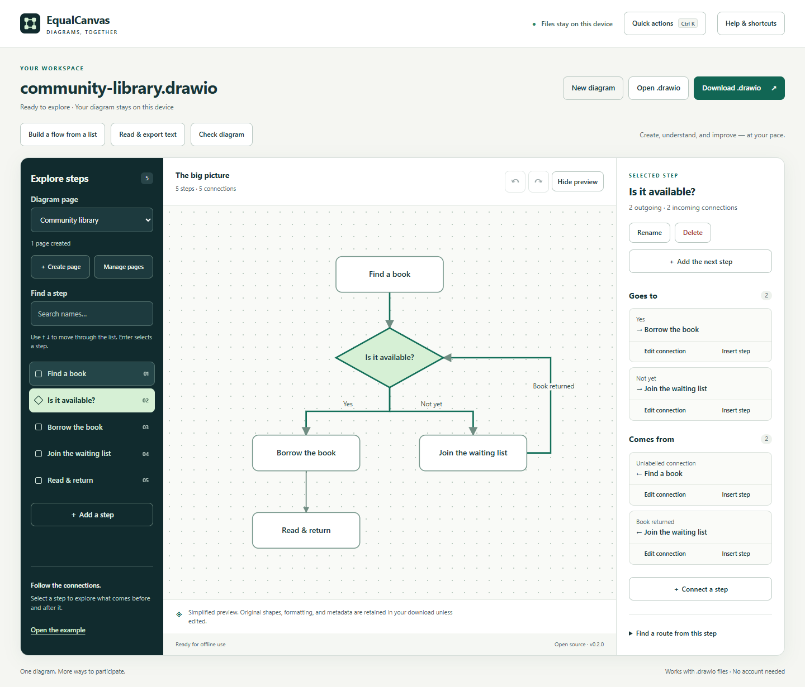

# EqualCanvas

**Explore a diagram by following its connections. Edit it. Share the same file back.**

EqualCanvas is an open-source browser app for exploring and editing draw.io diagrams with a keyboard, screen-reader controls, and a synchronized visual preview. It runs locally and works offline after the app shell has been cached.



**Completely free:** no subscriptions, paid feature tiers, accounts, or API keys. Free to use, study, change, and share under the MIT license.

[About the project](https://haminyovanantonyfk-netizen.github.io/equalcanvas/about.html) · [Launch copy](LAUNCH.md)

## Try it

[Open EqualCanvas](https://haminyovanantonyfk-netizen.github.io/equalcanvas/), or run it locally:

```sh
node scripts/serve.mjs
```

Visit **http://127.0.0.1:4173**. Node.js 22 or later is recommended. There are **no production dependencies** and no API keys. Installation of development packages is only needed for tests.

The app starts with **0 pages created**. Choose **Create your first page**, or **Explore the example** to try a community library's borrowing process. In the example, select **Is it available?**, follow the **Yes** connection, and use **Insert step** to add a step to that route. Download the edited `.drawio` file and open it in draw.io.

## What works in v0.2.0

- Open compressed or uncompressed `.drawio` files and standalone `mxGraphModel` XML.
- Create, rename, duplicate, reorder, delete, and switch between pages. Page changes participate in undo/redo, including recovery of the last deleted page.
- Clear zero-page, zero-step, empty search, and unavailable-action messages with useful next actions.
- Build up to 100 connected steps from a list, with project, support-request, and learning-plan starters. Add a next step with its connection in one action.
- Search actions, pages, and steps through the keyboard-operated quick-actions menu.
- Read and download a plain-text outline of all pages, groups, steps, and incoming/outgoing connections.
- Review missing endpoints, ambiguous branch labels, duplicate names, disconnected steps, unreachable routes from the selected step, and loops. Jump directly to an item or edit a connection. Checks are structural observations, not a correctness score.
- Search steps and navigate incoming and outgoing connections.
- Navigate group membership and find a shortest directed route between steps.
- Add steps and decisions; rename steps; add, relabel, reconnect, split, and delete connections.
- Delete a group with its descendants and attached connections, with confirmation.
- Undo and redo up to 30 changes, subject to a bounded memory budget.
- Export an editable `.drawio` file, preserving untouched XML, custom attributes, styling, and geometry semantically. Serialization whitespace/quoting may change; this is not byte-for-byte preservation.
- Use a responsive visual preview, accessible native controls, focus management, and live action announcements.
- Install from a compatible browser and reopen offline after the first successful load.

## Keyboard use

| Key                         | Action                                     |
| --------------------------- | ------------------------------------------ |
| Tab / Shift+Tab             | Move between controls                      |
| Up / Down in the step list  | Move focus between steps                   |
| Home / End in the step list | First / last step                          |
| Enter / Space on a step     | Select it and focus its details            |
| Ctrl/Command+S              | Download the current diagram               |
| Ctrl/Command+K              | Find an action, page, or step              |
| Ctrl/Command+Z              | Undo a diagram change, outside text fields |
| Ctrl/Command+Shift+Z        | Redo a diagram change, outside text fields |
| Escape                      | Close the current dialog                   |

Screen-reader browse mode can intercept arrow keys. Use the reader's focus/forms mode in the step list, or navigate buttons using its standard commands. Relationship controls expose full labels even when the visual preview shortens them.

## Privacy and security

- Diagram contents remain in browser memory. There is no upload endpoint, account, analytics, advertising, or remote AI service.
- The service worker caches a fixed allowlist of public app assets. Imported diagrams are never stored in its cache, local storage, or IndexedDB.
- **Download your work before closing the tab.** Download requests are initiated by the browser; verify the file exists in your downloads.
- Your downloaded file contains the original diagram's metadata and embedded content. EqualCanvas does not scrub an imported document's authorship, hidden layers, custom attributes, or embedded images. Review a document before sharing it.
- Import does not render HTML from labels, fetch image URLs, execute scripts, or resolve external XML entities. Original markup may remain in the exported file, so it is still an untrusted document when opened elsewhere.
- Hosted access exposes normal request information (for example your IP address) to the hosting provider. Self-host locally to avoid contacting a host after obtaining the app.
- No API secrets are required. Never add tokens, private diagrams, `.env` files, or machine-specific configuration to this repository.

See [SECURITY.md](SECURITY.md) for boundaries and reporting.

## Limits and honest accessibility status

This is an early working release, not a claim of universal diagram accessibility. Automated WCAG checks and keyboard workflow tests do not replace evaluation with blind and low-vision participants. Physical Android/TalkBack and NVDA user testing remain needed; mobile browser emulation is not equivalent to device testing.

The visual preview simplifies rich text, custom shapes, images, edge arrow decorations, routing points, and relative positioning. Navigation follows each edge's `source` to `target`; an edge drawn without arrowheads is still traversed this way. Unknown attributes are retained, but their semantics are not interpreted. Inserted steps receive a basic layout and may need repositioning in draw.io. Renaming a label intentionally replaces its rich text with escaped plain text.

Limits: 8 MB input/export, 40 pages, 2,000 cells per page, 12 MB expanded data per compressed page, and 24 MB combined expanded page data. A current browser with `DecompressionStream('deflate-raw')` is needed for compressed imports. Uncompressed XML can be used when that feature is unavailable. Images, PDFs, and Visio files are not accepted.

Zero-page documents can be opened and edited, but create a page before downloading a `.drawio` file. Flow starters are intentionally simple examples; adapt them for your own work. Page duplication preserves embedded content and links; links that explicitly point to the source page are not rewritten. Checks show at most 100 observations at once, and quick actions show the first 40 matches to keep navigation manageable.

When an app update is ready, download your work and close all EqualCanvas tabs/windows before reopening. The service worker waits for existing sessions to finish instead of replacing code underneath an unsaved diagram.

## Development

```sh
npm ci
npx playwright install chromium
npm run check
npm test
npm run build
```

`npm run build` copies an explicit public-file allowlist into `dist/`. Serve that folder on any static HTTPS host. Relative URLs support hosting in a repository subdirectory. GitHub Actions runs checks and tests; a separate Pages workflow builds and deploys `dist/`.

Tests cover file preservation, compressed and multipage imports, malformed XML, expansion limits, hostile labels, group deletion, route loops, editing and download workflows, responsive layout, offline caching, and automated accessibility checks. Tests use generated public fixtures only.

To test using an existing Edge installation, set the `EDGE_PATH` environment variable to the executable path; do not commit machine-specific paths. `node scripts/icons.mjs` regenerates the app's PNG icons from its original SVG.

## Project structure

```text
app/          Public app, parser/editor, example, and offline worker
scripts/      Local server, build, icon generation, repository checks
tests/        Browser, model, accessibility, and security regression tests
.github/      CI and GitHub Pages workflows
```

## Why this exists

Visual and nonvisual teammates often spend extra effort adapting shared information. [Research on mixed-visual-ability teams](https://arxiv.org/abs/2601.22081) documents this work. [Benthic](https://vis.csail.mit.edu/pubs/benthic/), [TADA](https://arxiv.org/abs/2311.04502), and [Arboretum](https://arxiv.org/abs/2601.19168) explore important approaches to diagram access. EqualCanvas is an independent implementation focused on a practical import–edit–export workflow with existing `.drawio` files; it does not claim to invent accessible diagram editing or to outperform those systems.

## Contributing

See [CONTRIBUTING.md](CONTRIBUTING.md). Feedback from blind and low-vision users is particularly valuable. Please use synthetic diagrams when reporting issues and describe the browser, screen reader, task, expected behavior, and observed behavior. Do not include personal data or private workplace files.

## License

MIT. See [LICENSE](LICENSE). No affiliation with draw.io, diagrams.net, or the research projects cited above.
